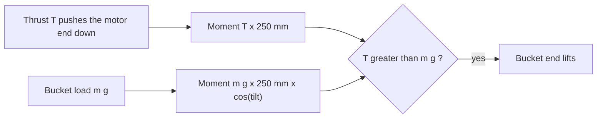

# OpenMotor-Seesaw

Filming jig for the OpenMotor video: a plain balance arm on an M8 bolt running in two 608ZZ bearings. An OpenMotor 2306 with a 5 inch prop sits on one end blowing upward, so its thrust pushes that end down. A bucket stands on a plate on the other end. The shot: the bucket end lifts. Both lever arms are 250 mm, so at level the motor lifts a bucket load equal to its thrust (measured max 1,711 g).

Five laser-cut 8 mm ply plates, one 3D-printed motor mount, standard hardware. All dimensions come from the parameter block at the top of `generate.py`.

```sh
python3 generate.py     # cut sheets (SVG, DXF), previews, viewer/model.json, motor_mount_params.scad
```

## 3D viewer

```sh
python3 -m http.server -d OpenMotor-Seesaw/viewer 8000    # from the repository root
# open http://localhost:8000
```

Orbit, tilt slider, exploded view, hover labels. three.js 0.160.0 comes from jsDelivr, so the page needs internet. Ply parts are extruded from the exact cut contours (`viewer/model.json`, written by `generate.py`). Motor and prop disc are envelopes, the printed mount is drawn from its platform and side plate outlines (the OpenSCAD file is the real model).

## Layout

```
       bucket plate on the arm end                    printed mount + motor, prop blows UP
      +--------------+                                         (o) prop disc 127 mm
 =====|==============|=========(O)=================================|====   arm, 8 mm plate on edge
       <---- 250 ---->   pivot: M8 bolt in 2 x 608ZZ   <------- 250 ------>
                          /\
                         /  \   two tower plates in slots
 ================== base plate, 300 x 220 =============
```



## The five plates (8 mm ply)

| # | Part | Size | Features |
|---|---|---|---|
| 1 | Base plate | 300 x 220 | Two 120 mm slots for the tower tabs, four 6.5 mm corner clamp holes, ESC zip tie slots |
| 2 | Tower, left | 160 foot, 190 + 22 mm | 120 mm tab, 608ZZ press-fit seat at the top |
| 3 | Tower, right | same | same |
| 4 | Arm | 550 x 40 | 8.3 mm bolt hole at the centre, a 4 x 3 grid of M3 holes at each end |
| 5 | Bucket plate | 130 x 130 | Sits on top of the arm end, 4 x 4 grid of M3 holes (two blocks of 4 x 2 either side of the arm) |

Hole grid: M3 clearance (3.4 mm), 10 mm pitch. Arm grid: 4 columns along the arm at 195, 205, 215, 225 mm from the pivot (both ends), 3 rows at 10 mm pitch centred on the arm height. Bucket plate grid: the same four columns, rows at 14 and 24 mm either side of the arm centreline, so a printed bracket can bolt to the arm face and to the plate. The bracket itself is not part of this directory.

Printed part: `motor_mount.scad` (parameters in `motor_mount_params.scad`, generated). A saddle: two 4 mm side plates clamp the arm with 12 M3 screws through the arm grid, a platform floats 3 mm above the arm top and carries the motor 40 mm farther out, so the motor axis is at exactly 250 mm. Four slotted holes cover both 16 x 16 and 19 x 19 mm M3 patterns (slots on the diagonals from 11.3 to 13.4 mm radius), 14 mm centre hole for shaft and circlip, wire slot toward the arm. Not printed or test-fitted yet.

## Dimensions

| Item | Value |
|---|---|
| Arm, pivot to motor axis = pivot to bucket plate centre | 250 mm each |
| Pivot axis height above table | 190 mm |
| Tower spacing (inner faces) | 36.4 mm |
| Prop | disc 127 mm, centre about 63 mm above the arm top edge; with the motor end down at 25 degrees the lowest blade edge is about 115 mm above the table, the nearest disc edge is 142 mm from the pivot plane (towers reach 80 mm) |
| Estimated mass | about 1 kg ply, 26 g bucket end heavier before brackets (estimate) |

Parameters: `PLY_T` (8), `KERF` (0.15), `ARM`, `PIVOT_H`, bearing and hardware dimensions, grid. Kerf rule: holes are cut smaller, slots narrower, tabs wider by `KERF`; outer outlines are not offset. The 608ZZ seat is 21.90 mm actual (cut path 21.75). The bearing is 7 mm in 8 mm ply, so it sits 1 mm recessed on the inner face; press it flush with the outer face. Measure your ply (often 0.2 to 0.5 mm off) and set `PLY_T`; cut a test seat and slot first.

## Travel limit

There are no end stops. Only the arm tip limits travel: the lower tip corner reaches the table at about 39 degrees, and it has 56 mm of clearance at 25 degrees, the intended working range of roughly plus or minus 25 degrees. At that tilt the arm underside also clears the base edge. Nothing stops the arm before the table: do not run the motor with the bucket end unsupported. Because the bucket stands on the plate, it will slide off a plate tilted by 25 degrees unless the founder's bracket or the bucket shape holds it.

## Pivot stack (one M8 bolt)

The M8 bolt runs through both bearings and the arm. The arm is clamped to the bolt, so arm and bolt turn together inside the bearings. Left to right:

| Item | Thickness mm |
|---|---|
| Bolt head (on the left inner race, outside the left tower) | 5.3 |
| M8 washer (outside) | 1.6 |
| Tower with 608ZZ (race flush with the outer face) | 8 |
| M8 nut as spacer against the left inner race | 6.8 |
| M8 clamp nut | 6.8 |
| M8 washer | 1.6 |
| Arm | 8 |
| M8 washer | 1.6 |
| M8 clamp nut | 6.8 |
| M8 nut as spacer against the right inner race | 6.8 |
| Tower with 608ZZ | 8 |
| M8 washer (outside) | 1.6 |
| M8 nut (outside) | 6.8 |

The inner stack is 38.4 mm; the towers are 36.4 mm apart (the races are recessed 1 mm in each tower). Required bolt: head underside to tip at least 62.4 + 3 mm thread protrusion = 65.4 mm, so an M8 x 70 bolt, fully threaded (ISO 4017 / DIN 933), because the clamp nuts sit in the middle of the shank. The spacers touch only the inner races, so the arm and the clamp stack cannot rub the towers.

Clamp the arm first: tighten the two clamp nuts against the washers either side of the arm with thread locker, then jam each spacer nut against its clamp nut. Then fit the bearings and tighten the outer nut only until the stack is snug against both inner races. Do not squeeze the races hard. If the nut bottoms out too soon or the stack floats, trade a washer. The torque from 1.7 kg at 250 mm is about 4.2 N m through two washers' friction; that has not been tested, check by hand with a heavy bucket before filming and add a thread locker or a hex nut pocket if the arm slips.

Check that the outside washers do not touch the bearing shields (the shield is usually slightly recessed); if they do, swap them for a nut.

## Bill of materials

| Qty | Part |
|---|---|
| 2 sheets | 600 x 400 mm 8 mm birch ply (sheet 1: base, left tower, bucket plate; sheet 2: right tower, arm) |
| 2 | 608ZZ bearing |
| 1 | M8 x 70 fully threaded bolt (steel) |
| 6 | M8 nut (2 clamp, 2 spacer, 1 outside, 1 spare) |
| 5 | M8 washer ISO 7089 (2 clamp, 2 outside, 1 spare) |
| 4 | M3 x 10 screw for the motor (check the motor's maximum screw depth) |
| 12 | M3 x 20 screw and nut for the printed mount |
| 1 | 3D-printed motor mount (`motor_mount.scad`) |
| - | Thread locker, wood glue, zip ties 2.5 mm |
| 1 | Bucket and the founder's bracket (not included) |

## Assembly

1. Dry-fit the five plates. Sand the tab if ply is thicker than `PLY_T`.
2. Press the two towers into the base slots (tab through the base), glue the tabs. Check both towers are square and parallel; a tab in a single slot resists leaning sideways only through the glue, so glue well.
3. Press a 608ZZ into each tower seat from the outside, on the outer race only.
4. Build the pivot as described above, then slide the bolt through the bearings with the arm between the towers.
5. Bolt the printed mount to the arm end (12 M3 screws), screw the motor on from below with M3 x 10 and fit the prop.
6. Place the bucket plate on top of the other arm end and fix it with the founder's bracket. Both ends use the same hole grid, so the two ends are interchangeable.

Route the motor wires along the arm with zip ties through spare grid holes to an ESC strapped to the base near the pivot (zip tie slots on the base). Leave a slack loop at the pivot: stiff cables add torque error in this experiment.

## Balancing

There is no counterweight slot. Estimated empty end masses: the bucket plate is about 91 g at the bucket end, the motor end is about 65 g (motor 33, printed mount about 25, prop 5, screws 2); all of these are estimates and the founder's bracket adds more. Weigh both ends and adjust: shorten or lighten the bucket plate (`BUCKET_PLATE`), or add washers on the light end through spare grid holes. The arm should stay level where you leave it with the bracket and empty bucket in place.

## The filming bet

At level, the motor wins when its thrust exceeds the bucket load weight (equal arms, thrust perpendicular to the arm, so the moment is exactly T x 250 mm). The load's moment shrinks by cos(tilt), so after it starts moving it gets easier; the lift is decided at level. With 1,711 g thrust the load to beat is under 1.711 kg minus friction and cable stiffness: the margin is small. Weigh the bucket on a scale before the take.

## Flipped prop (read this)

For the prop to blow up with the motor under it, the thrust on the motor must point down. A normal prop on top of a motor pushes air down. The plan is to flip the prop and reverse the motor direction in AM32, which gives reverse thrust; that is normally weaker than forward thrust. The 1,711 g figure is only valid if it was measured the same way. Re-measure the thrust with the exact flipped-prop setup on a scale before the shoot.

## Safety

Keep hands, face and loose items out of the prop disc and above it; wear eye protection, keep the motor disarmed until the area is clear, use a current-limited supply and a switch you can reach. Nothing of the jig is above or in the prop wash. The base is 300 x 220 x 8 mm and has four clamp holes; clamp it to the table if you expect bumps.

## Tip-over

`generate.py` prints this. In the balanced case the load (thrust plus payload plus weight) goes through the pivot, centred on the base, with no overturning moment. If the motor end is pushed down against the table, the table carries nearly all of the thrust (about 15 N of 16.8 N) and the towers see about 1.5 N. The arm never loads the base edge because the base is shorter than the arm. This is a static estimate; the towers are glued tab joints.

## Files

| Path | What |
|---|---|
| `generate.py` | Generator, Python stdlib only |
| `cut/sheet-1.svg`, `cut/sheet-2.svg` and `.dxf` | Cut files, red 0.01 mm hairline, 600 x 400 mm |
| `images/sheet-*.png` | Labelled previews (rsvg-convert) |
| `motor_mount.scad`, `motor_mount_params.scad` | Printed motor mount (second file is generated) |
| `viewer/` | Three.js viewer and `model.json` |

The DXF is a plain R12 file (POLYLINE and CIRCLE on layer CUT), not opened in any CAD tool yet; use the SVGs if it misbehaves.

## Unverified

- The OpenMotor 2306 mounting pattern (16 x 16 or 19 x 19 M3) is not stated in the OpenMotor README; the slots cover both. The founder wrote "2605", taken to mean the 2306.
- Motor height (31 mm), diameter (28 mm), the 14 mm centre hole and the prop plane height (36 mm) are estimates.
- The printed mount, the pivot clamp torque and the tower rigidity are untested.
- All masses are estimates.
- Reverse thrust of the flipped prop is unknown.
