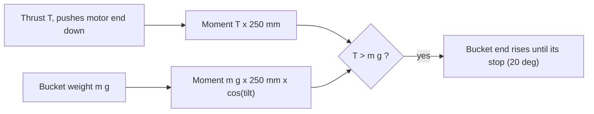

# OpenMotor-Seesaw

Filming jig for the OpenMotor video: a balance beam on two 608ZZ bearings. One OpenMotor 2306 with a 5 inch prop sits on one end, blowing up, so its thrust pushes that end down. A bucket on the other end collects motors (about 33 g each). The shot: the bucket end lifts. At level, with the beam balanced empty, the motor lifts a bucket content mass equal to its thrust (measured max 1,711 g).

Everything is laser-cut 8 mm birch ply plus hardware. All dimensions come from the parameter block at the top of `generate.py`; change it and rerun.

```sh
python3 generate.py                      # cut files, previews, viewer/model.json
python3 generate.py --bearing printed    # variant with a printed bearing housing, see below
```

## 3D viewer

```sh
python3 -m http.server -d OpenMotor-Seesaw/viewer 8000    # from the repository root
# open http://localhost:8000
```

Orbit, tilt slider within the end stops, exploded view, optional prop guard, hover labels. three.js 0.160.0 is loaded from jsDelivr, so the page needs internet. The ply parts are extruded from the same contours that go to the laser (`viewer/model.json`, written by `generate.py`). Motor, prop disc and bucket are envelopes, not real geometry.

## Layout

```
        stop post                                  stop post
           |                                           |
   hook    |        beam (3 plies, 40 mm high)         |   motor plate
  (o)======+====================(O)====================+====[motor]
   |   counterweight slot     pivot (2 x 608ZZ, M8)     |    prop ~ 127 mm disc, blows UP
 bucket                          /\                     |
   |                            /  \  A-frame uprights  |
 ==========================  base, 2 glued layers  ==============
        arm = 250 mm                    arm = 250 mm
```



## Dimensions (from `generate.py`, 8 mm ply)

| Item | Value |
|---|---|
| Arm, pivot to motor axis and pivot to hook | 250 mm each |
| Pivot axis height above table | 250 mm |
| Base | 420 x 240 mm, two glued 8 mm layers (16 mm) |
| Uprights | two A-frame plates, 220 mm base, 30 mm gap between them |
| End stops | posts at x = 190 mm, 143.6 mm tall above the base, beam stops at +-20 deg |
| Beam | 544 x 40 mm centre ply plus two 456 x 40 mm outer plies, 24 mm total |
| Hook | 10 mm hole in the centre ply at 250 mm, at pivot axis height |
| Prop centre height | about 225 mm above the table with the motor end at its lowest stop (lowest blade edge about 203 mm), more elsewhere |
| Prop to uprights | nearest prop disc edge at least 153 mm from the pivot plane at worst tilt; nothing of the jig is above the disc |
| Bucket clearance | the hook is 164 mm above the table at its lowest, so the bucket may hang about 150 mm below the hook |
| Jig mass | about 1.5 kg static plus 0.3 kg beam (estimate from ply area at 0.68 g/cm3) |

Parameters worth knowing: `PLY_T` (8), `KERF` (0.15), `SLOT_FIT`, `PRESS_FIT` (0.10), `ARM`, `PIVOT_H`, `BEARING_*`, `ROD_*`. Kerf rule: holes are cut smaller, slots narrower, tabs wider by `KERF`; outer outlines are not offset. A 608ZZ seat is cut at 21.90 mm actual (path 21.75). The bearing is 7 mm in 8 mm ply, so it is recessed 1 mm on the inside face; press it flush with the outer face. Measure your ply (it is often 0.2 to 0.5 mm off nominal) and set `PLY_T`; cut one test slot and a test bearing seat first.

## Files

| Path | What |
|---|---|
| `generate.py` | Generator, parameters at the top, Python stdlib only |
| `cut/sheet-1..3.svg/.dxf` | Required parts on three 600 x 400 mm sheets, red 0.01 mm hairline |
| `cut/optional-1.svg/.dxf` | Prop guard parts (plate, ring, two legs) |
| `images/*.png` | Labelled previews of each sheet (rendered with rsvg-convert) |
| `viewer/` | Three.js viewer and `model.json` |
| `bearing_housing.scad` | Printed bearing housing alternative, untested |

Sheet contents: sheet 1 uprights, posts, beam centre ply, motor plate, tie plates; sheet 2 and 3 one base layer each, sheet 2 also the two outer beam plies. Cut `base` twice (one per sheet) and glue. The DXF is a plain R12 file with POLYLINE and CIRCLE entities on layer CUT, not opened in any CAD tool yet; use the SVGs if the DXF misbehaves.

## Bill of materials

| Qty | Part |
|---|---|
| 3 sheets | 600 x 400 mm 8 mm birch ply (plus offcuts for the optional guard sheet) |
| 2 | 608ZZ bearing |
| 1 | M8 x 80 full-thread bolt or threaded rod (steel) |
| 4 | M8 nut (2 captured in the beam, 2 outside the bearings) |
| 4 | M3 x 10 screw for the motor, check the motor's maximum screw depth |
| 4 + 4 | M3 x 30 screw and nut, beam stack clamp (optional with glue) |
| 1 | M5 x 35 bolt, 3 nuts and a few washers, counterweight |
| 8 | 2.5 mm zip ties (wires on the beam, ESC on the base) |
| 1 | S-hook or wire hook for the bucket |
| 2 | Felt or rubber pads for the stop posts |
| - | Wood glue, thread locker (for the captured nuts and the M8 outer nuts) |
| 1 | Bucket (not included, any light bucket with a wire handle) |

## Assembly

1. Dry-fit everything. Sand tabs if the ply is thicker than `PLY_T`.
2. Glue the two base layers. Glue the uprights (tabs go through both layers) and stop posts into the base, then the two tie plates between the uprights. Check the uprights are square to the base.
3. Glue the beam: centre ply (with the hook hole and the motor tab) between the two outer plies. The motor tab is on the end with no slot. The outer plies end 22 mm before the beam ends.
4. Drop an M8 nut into each hex pocket from the outside, with thread locker, so each nut sits against the centre ply. Pass the M8 rod through both nuts and the centre ply hole, and lock it with thread locker. The rod must not turn in the beam: the pocket carries the torque, nothing else does. The nuts sit 1.2 mm below the ply face (pocket is 8 mm, nut is 6.8 mm); that is intended.
5. Press the two 608ZZ into the upright seats from the outside, flush with the outer face. Use a vise or a nut-and-bolt press on the outer race only, never on the inner race.
6. Slide the rod through both bearings (beam between the uprights) and snug an M8 nut on each end against the inner race only, with thread locker. The beam must float between the uprights with a few mm of clearance each side.
7. Glue the motor plate onto the beam end (tab through the slot). Screw the motor on from below with M3 x 10. Fit the prop with the spin direction and thrust direction described below.
8. Stick felt on the stop posts. Hang the bucket from the hook hole.

Motor wires pass through the 12 x 8 mm slot beside the motor tab, run along the beam with the zip tie slots, and reach an ESC strapped to the base near the pivot (slot pairs on the base). Leave a slack loop at the pivot so the cables exert no torque on the beam; stiff cables are the biggest hidden error in this experiment.

## Balancing

The motor, plate, prop and wires are heavier than the empty bucket end. Balance with the final prop, wires and the empty bucket hung:

1. Put the base on a flat table and let the beam swing free.
2. Put an M5 bolt through the counterweight slot (115 to 215 mm from the pivot, bucket side) with nuts and washers.
3. Move it outward to add moment, inward to reduce. The moment is mass x distance: a 40 g counterweight at 200 mm balances 32 g at the 250 mm motor end. Small corrections: washers or a strip of tape.
4. The beam is balanced when it stays level where you leave it between the stops. A residual of about 1 to 3 g equivalent is likely bearing grease drag (an estimate, not measured); washing the bearings in isopropyl and relubricating thin reduces it.

Do the trim again after anything is added to the motor end (guard ring, new wires). Trim to the empty bucket; the motors then go into the bucket, and the beam stays balanced when the bucket is empty.

## The filming bet

At level, the motor wins when its thrust is greater than the bucket content weight (equal arms, thrust perpendicular to the beam, so the moment is exactly T x 250 mm). The weight's moment shrinks by cos(tilt), so once the bucket moves, the same thrust balances about 1.8 kg at the 20 degree stop; the lift is decided at level. At 1,711 g thrust, the content mass to beat is less than 1.711 kg minus friction and cable stiffness: the margin is small, so stack motors until the bucket just stays down, then add the last one on camera. Use a known-mass scale for the bucket before the take.

Open items before filming:

- Thrust direction. A normal prop on top of a motor pushes air down and the motor up. For air to go up with the prop above the motor you need a reverse-thrust setup (reversed spin plus a flipped or pusher prop). A normal prop spun in reverse usually gives clearly less than its forward thrust. Re-measure the thrust in the exact configuration used on the jig; the 1,711 g number is only valid if it was measured the same way.
- The motor mount pattern is 16 x 16 mm M3 here. Not verified: it is not stated in the OpenMotor repository README. Check the motor before cutting the motor plate.
- Motor height (31 mm), diameter (28 mm) and the prop plane height above the plate (36 mm) are estimates for the model and the prop guard leg height. Measure them.

## Tip-over

`generate.py` prints this check. The end stops are inside the base footprint (posts at 190 mm, base half-length 210 mm), so the stop load goes into the base, not past its edge. With the motor end hard against its stop the stop pushes down about 22 N and the pivot pulls up about 5 N: safety factor about 4.7 against tipping with the jig weight alone (estimate), static only. The base has four 6.5 mm holes at the corners; clamp it down with G-clamps or weigh it down if you want margin for bumps. The pivot uplift is carried by the glued tab joints of the uprights.

## Prop guard (optional)

`optional-1` holds a wider motor plate (use it instead of the plain one), two legs and a ring (134 mm inside diameter, 5 mm clearance around a 127 mm prop). Glue legs into the plate, then the ring onto the legs. It adds roughly 50 g at the motor end (estimate), so rebalance. Without it, keep everything and everyone out of the prop disc and above it, wear eye protection, and keep the motor disarmed until the bucket is loaded and the area is clear. The prop wash goes up; nothing of the jig is in it. Use a current limited supply and a switch you can reach.

## Printed bearing housing (optional)

`python3 generate.py --bearing printed` writes `*-printed` sheets with a 12 mm hole and four M3 holes on each upright instead of the press-fit seat. Print `bearing_housing.scad` twice, bolt one to the outside of each upright with M3 x 20, and use an M8 x 100 rod. Untested; the 3D viewer shows the press-fit design.
